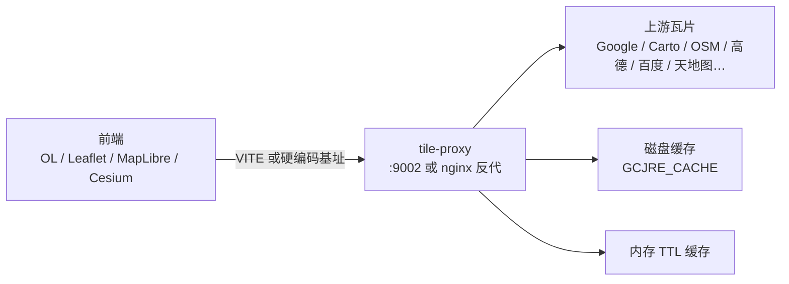
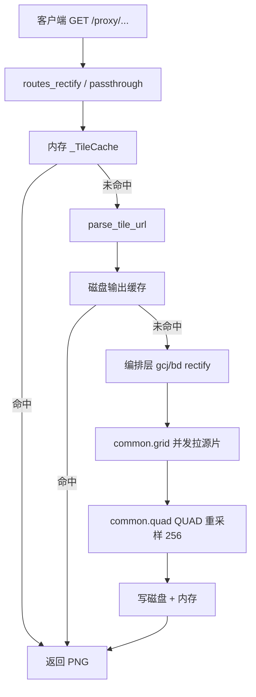

# 架构说明

本文从 WebGIS 项目的纠偏体系文档迁入并改写，描述 **tile-proxy 独立服务** 的原理与模块边界。

**延伸阅读：**

- [非标准 XYZ 与 GCJ-02](https://www.negiao.cn/Pages/Note/note-viewer/note-viewer.html?note=non-standard-xyz-and-gcj02)
- [纠偏接缝与 QUAD 重采样](https://www.negiao.cn/Pages/Note/note-viewer/note-viewer.html?note=tile-rectify-seam-quad-resampling)

## 1. 定位



服务做两件事：

1. **直通代理**：代浏览器取第三方瓦片/文档，补 UA/Referer，回 CORS。
2. **纠偏代理**：按请求网格重采样，输出与标准 XYZ（或百度网格）对齐的 PNG。

## 2. 为什么必须纠偏

| 坐标系 | 谁在用 | 与 WGS84 |
|---|---|---|
| WGS84 | GPS、OSM、Esri、多数 Web 地图工作空间 | 基准 |
| GCJ-02 | 高德、腾讯、谷歌中国、天地图 | 非线性偏移，城区可达数百米 |
| BD-09 | 百度 | GCJ 之上再加偏 |
| BD09MC | 百度瓦片网格 | **独立投影 + 独立网格**（不只是坐标值偏） |

把 GCJ 瓦片当标准 XYZ 贴到 WGS84 画布 → **整城错位**。

### GCJ vs BD 的本质差别

| | GCJ-02 ↔ WGS84 | BD-09 ↔ WGS84 |
|---|---|---|
| 网格 | **同**标准 Web 墨卡托，仅坐标值偏 | **跨网格**（BD09MC 原点居中、Y 向上） |
| 分辨率 | 同 z 1:1 | 约 `z_bd ≈ z±1` 对齐 |
| 做法 | 同索引换 bbox → QUAD | 拉覆盖网格 → Y 翻转 → QUAD |
| 重采样 | BILINEAR | BICUBIC（约 306→256） |
| z≤9 | 直通源片（偏差亚像素） | 同左 |

**百度墨卡托不是球面墨卡托**，而是 JS API 的分段六阶多项式。用球面公式近似在北京会偏约 15–23 km——实现见 `domains/tiles/rectify/bd/mercator.py`。

网格定义与「不能当标准 XYZ」的展开说明：[非标准 XYZ 与 GCJ-02](https://www.negiao.cn/Pages/Note/note-viewer/note-viewer.html?note=non-standard-xyz-and-gcj02)。

## 3. 请求链路



依赖铁律：`bd → common ← gcj`；`common` 不 import 兄弟包。

## 4. 模块职责

| 路径 | 职责 |
|---|---|
| `app.py` | FastAPI、CORS（默认 `*`）、挂载 `tiles_router`、启停磁盘清理 |
| `config.py` | 仅 env 的 get_str/int/bool + 瓦片 Cache-Control 策略 |
| `cache_policy.py` | 纯 ASGI 中间件：统一改写 200 图片响应的 Cache-Control |
| `origin_guard.py` | 可选来源白名单（默认不挂载，`TILE_PROXY_ENFORCE_ORIGIN=1` 才启用） |
| `domains/tiles/_router.py` | **先**纠偏路由，**后**通配直通（顺序=正确性） |
| `routes_rectify.py` | 4 条纠偏端点 + 错误码 400/504/502 + 出口质量标记 |
| `routes_passthrough.py` | `/proxy/{url}` 流式直通（1.1.0 起移除 ships66 端点） |
| `proxy_shared.py` | 内存缓存、限流、SSRF、出站 httpx |
| `cache_cleanup.py` | 按龄 + 按容量清磁盘缓存 |
| `infra/net_guard.py` | 私网/DNS 复判/白名单 |
| `infra/http_headers.py` | 浏览器 UA、sec-ch-ua、Referer 白名单 |
| `rectify/common/transform.py` | WGS/GCJ/BD 点坐标互转（含牛顿迭代逆解） |
| `rectify/common/grid.py` | 信号量并发、字节/像素/网格数护栏、文件缓存、拼接、输出有效性校验 |
| `rectify/common/quad.py` | 四角 QUAD 透视（几何无缝原语；见[接缝与 QUAD 笔记](https://www.negiao.cn/Pages/Note/note-viewer/note-viewer.html?note=tile-rectify-seam-quad-resampling)） |
| `rectify/gcj/rectify.py` | GCJ 编排 |
| `rectify/bd/*` | BD09MC 投影 + 跨网格编排 |

## 5. URL 模板

客户端传入的是**带真实坐标的完整上游 URL**。解析三档：

1. **format**：正则找 `x=` / `tilecol=` 等，替换为 `{x}{y}{z}`
2. **query**：`parse_qsl` 只换三键
3. **path**：路径数字 token 全枚举，专治 Google `maps/vt pb=!1m4!...`

模板指纹 `sha1(template)[:16]` 作磁盘缓存顶层目录，不同样式天然隔离。

## 6. 护栏

| 项 | 默认 | 作用 |
|---|---|---|
| `GCJRE_TILE_MAX_MB` | 8 | 单源片字节上限 |
| `GCJRE_MAX_IMAGE_PIXELS` | 16M | 解压炸弹 |
| `GCJRE_MAX_TILES_PER_REQUEST` | 64 | 单请求网格片数 |
| `GCJRE_MAX_CONCURRENCY` | 16 | 源片并发（VPS 建议 4） |
| `PROXY_RATE_LIMIT` | 0 | 每 IP 限流（公网必开） |
| `PROXY_ALLOW_PRIVATE_HOSTS` | false | SSRF |

**单片失败不补空白**：重试 `GCJRE_FETCH_ATTEMPTS`（默认 3）次后仍失败即抛错，整块请求以 5xx 结束
（5xx 不被 nginx / CDN 缓存）。输出侧另有一道有效性校验，把"缺片导致的大块透明"挡在落盘之前。

### 6.1 缓存分层与有效性

**三层缓存，各管一段**：

| 层 | 默认 TTL | 说明 |
|---|---|---|
| 进程内 `_tile_cache` | 300s（`PROXY_TILE_CACHE_TTL_SECONDS`） | 纠偏**输出**的内存缓存，纯内存无持久化 |
| 磁盘 `GCJRE_CACHE` | 7 天（`GCJRE_CACHE_MAX_AGE_DAYS`） | 分 `source-*`（源瓦片）与 `gcj2wgs2`/`wgs2gcj2`/`bd2wgs2`/`wgs2bd2`（输出）两类目录 |
| 上游 CDN（如 Cloudflare） | 由 `Cache-Control` 决定 | 见下 |

**响应头由 `cache_policy` 中间件统一写入**（纯 ASGI，只改 `http.response.start`，不碰 body）：

```
Cache-Control: public, max-age=<TILE_BROWSER_TTL_SECONDS>, s-maxage=<TILE_EDGE_TTL_SECONDS>
```

覆盖范围是 **200 + `image/*`**，并剥掉上游带来的 `expires`/`pragma`。动机：上游各源的
`cache-control` 差异极大（Google 卫星 257 天、高德与 Google 路网 1 小时、纠偏路由干脆没有），
原样透传会让浏览器缓存时长失控——一旦某块瓦片被缓存成坏图，CDN purge 清得掉边缘、清不掉浏览器。

> ⚠️ `origin_guard` **不改写** `Cache-Control`。它曾统一打 `private, max-age=300` 以阻止
> CDN 缓存、保住防盗链白名单，但 `private` 会让共享缓存全部 BYPASS，与边缘缓存直接互斥。
> 现在分工明确：origin_guard 管「谁能访问」，cache_policy 管「能存多久」。
> 代价是边缘缓存后缓存键只有 URL，白名单在 CDN 层失效。

**有效性校验**：`grid.assess_tile_quality(data, source_bytes_total, source_pixels)` 三条判据，
任一条不过即判废，由四个纠偏入口（`gcj2wgs`/`wgs2gcj`/`bd2wgs`/`wgs2bd`）**强制重取一次**
（`force_refresh=True` 绕过源瓦片缓存），仍不合格则不落盘、响应打 `no-store` + `X-Tile-Blank: 1`：

1. **透明像素占比** > `GCJRE_MAX_TRANSPARENT_PERCENT`（默认 10%）—— 透明 = 源网格缺片，主判据；
   另有**不变量**：源网格全不透明时，输出出现 >0.5% 透明即判废（warp 只从合成图内部取样，
   全不透明的输入产不出透明像素；出现透明说明有源片被空白顶替）。源本身含透明时不套用，
   避免真覆盖边界被无限重试；
2. **输出 B/px** < 源同指标的 0.2 倍 —— 纠偏是裁剪不是缩放，输出应与源同量级。
   两侧都按「字节/像素」归一：输出用自身像素数，源用源网格真实像素数（`片数 × 256²`，
   由调用方传入）。若图省事拿源字节直接除以输出像素，2×2 网格会把源的 B/px 放大 4 倍，
   海面/沙漠这类正常但极好压的瓦片会被误判成「丢细节」，陷入每请求强制重取 + 永不缓存；
3. 解码失败。

> **不透明白色一律放行**。那是上游真实的覆盖边界（卫星影像范围外），误判会让空白区域
> 陷入无限重试、反复回源。只认「透明」这个确定性信号。

### 6.2 两层校验与源片复用

**第一层：逐张源片**（`_validate_source_tile`，最关键）。一个纠偏输出要拉 2×2 张源片，
**任何一张是坏的，输出就会缺一条**，而且会被磁盘 / nginx / CDN 逐层放大。所以在**落盘之前**
逐张校验：非空 → 字节数 ≥ 100（错误页/截断）→ 能解码且宽高 ≥ 32 → 不是全透明空白片。
不合格抛 `SourceTileError`，由 `_fetch_tile_grid` 重试 `GCJRE_FETCH_ATTEMPTS` 次
（**重试绕过缓存**，因为缓存里那份很可能就是刚被判废的坏片），仍失败则整块 5xx（各层不缓存）。

> 为什么敢把「全透明源片」判死：高德对无覆盖区返回的是**不透明白色/纯色**瓦片
> （抽查 z3/z5/z10/z13/z17 五个海洋与边缘瓦片，alpha 全 255），全透明只可能是上游抖动。

**第二层：合成输出**（`assess_tile_quality`）。透明率、体积比、能否解码；透明率与**源网格**
比较（容差 1 个百分点），多出来的透明就是缺片。判废后 `force_refresh=True` 重取一次。
**判废结论会一路回传**：`_build_with_quality` / bd 的循环返回 `(bytes, ok)`，调用方据此
**不落盘**，路由据此打 `no-store` + `X-Tile-Blank: 1` 且不进内存缓存——不会出现「磁盘拒收、
内存照收」的分裂。

> 两个细节（2026-10-29 全链路复查）：① 透明统计口径统一为 `alpha < 255`，出口侧原来只数
> `alpha == 0`，会漏掉 BILINEAR 在透明边缘混出的半透明像素；② 源片尺寸必须**精确**
> `256×256`，`_merge_tiles` 是按网格位置直接 `paste` 的，尺寸不符会静默错位（拼接前还有
> 一道断言兜底）。

**源片复用**：源片按 `(模板 cache_key, z/x/y)` 落盘缓存，**相邻输出瓦片天然共享**——
一个 4×4 的输出块只需 5×5=25 张源片，而不是 16×4=64 张。串行场景本来就是最优的 25 次；
但**并发**场景下（一屏几十张同时算）会各自 miss 缓存、重复回源，实测 16 张并发 →
25 张源片被请求 **186 次**。`_SOURCE_LOCKS`（单飞锁 + 二次检查）把它压回 **25 次**，
同时 3×3 并发耗时从 19.8s（串行）降到 0.92s。

**回源并发是进程级闸门**（`_get_fetch_semaphore()` → `GCJRE_MAX_CONCURRENCY`，默认 16）：
早先每个 `_fetch_tile_grid` 各建一个信号量，一屏 30 张输出就能打出去 30×16 路，
只靠 httpx 连接池兜底。改成全局后实测 3 个 4×4 块并发（75 张唯一源片）峰值并发 11。

## 7. 已知约束

1. z≤9 GCJ 直通是近似（&lt;1px）。
2. 百度街道底图验证到 z18，更高层先实测。
3. `wgs2bd` 的输入索引是**百度网格**；`bd2wgs` 是**标准 XYZ**——传错会静默错位。
4. 境外 `out_of_china` 直通，是 feature。
5. 磁盘清理与写缓存为 best-effort，无文件锁。

## 8. 历史来源

实现自 WebGIS-Dev `backend/domains/tiles/` 抽出（2026-09），使托管平台上的业务后端不再承担第三方内容中转。
